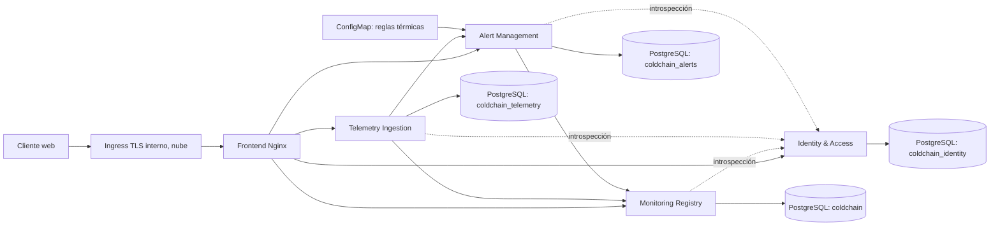

# ColdChain Sentinel en Kubernetes

Manifiestos Kustomize para Identity & Access, Registry, Telemetry, Alerts y el frontend.
Las APIs exigen una sesión Bearer emitida por Identity & Access (EP-01); cada servicio
la valida contra `/api/v1/auth/introspect`.



## Capas

| Ruta | Contenido |
|---|---|
| `base/` | Cinco Deployments y Services internos, estrategia RollingUpdate, sondas, solicitudes y límites. HPA por CPU para Telemetry y Alerts, de 1 a 3 réplicas, objetivo 70 %. |
| `overlays/local/` | Namespace `coldchain-local`, imágenes de Docker Desktop, PostgreSQL 16 con PVC de 1 GiB y ConfigMap de reglas de demostración. El cliente se prueba con port-forward. |
| `overlays/cloud/` | Plantilla de namespace `coldchain`, referencias a imágenes GHCR y un Ingress TLS. Requiere clase de Ingress interna, host, certificado, base de datos y Secrets del ambiente. |

Registry usa TCP para vitalidad y HTTP para disponibilidad con base de datos. Identity,
Telemetry y Alerts usan los grupos Actuator de vitalidad y disponibilidad. Los servicios se
comunican con DNS interno del namespace. Los pods de aplicación corren sin root ni
token de cuenta de servicio. La base local usa un usuario de demostración con cuatro
bases lógicas. En la nube, preparar usuarios independientes de mínimo privilegio.

Los HPA necesitan un proveedor de `metrics.k8s.io`; aplicar sus objetos no demuestra
escalado. El Ingress requiere un controlador existente y una clase configurada.

## Prueba en Docker Desktop

Ejecutar en PowerShell desde la raíz del repositorio:

```powershell
kubectl --context docker-desktop get nodes
docker compose -p coldchain-k8s build identity-access monitoring-registry telemetry-ingestion alert-management frontend
pwsh -NoProfile -File infrastructure/kubernetes/Deploy-Local.ps1
pwsh -NoProfile -File infrastructure/kubernetes/Test-Local.ps1
kubectl --context docker-desktop -n coldchain-local get deploy,pods,svc,pvc,hpa
```

El despliegue genera una contraseña local al crear el PostgreSQL de prueba y otra para el
administrador inicial (Secret `identity-access-bootstrap`, usuario `admin`). Las siguientes
ejecuciones conservan ambas y reutilizan el volumen; si el PVC es anterior a Identity, el
script crea la base `coldchain_identity`. La prueba inicia sesión con ese administrador,
registra un punto nuevo, configura su regla de 2 a 8 °C por la API de Alerts (HU-09),
envía 10 °C y comprueba la persistencia y la alerta abierta. Para leer la contraseña del
administrador:

```powershell
kubectl --context docker-desktop -n coldchain-local get secret identity-access-bootstrap -o jsonpath='{.data.BOOTSTRAP_ADMIN_PASSWORD}'
```

El valor está en Base64. El navegador puede
usar un port-forward equivalente con `kubectl --context docker-desktop -n coldchain-local
port-forward service/frontend 18080:8080` y abrir `http://localhost:18080`.

## Entrega por GitHub Actions y preparación en Azure

[`kubernetes.yml`](../../.github/workflows/kubernetes.yml) renderiza las dos capas
y adjunta los YAML a la ejecución. El job de publicación se habilita desde `main` y usa
el SHA completo para construir y publicar las cinco imágenes en GHCR. Si los paquetes
ya existen, verificar que concedan escritura al repositorio y acceso de lectura al
clúster. El YAML cloud que publica el workflow es una plantilla con valores que el
operador debe completar.

Para el primer despliegue de integración en nube:

1. Seleccionar la ejecución con las cinco imágenes publicadas y usar ese mismo SHA
   en las cinco entradas de `overlays/cloud/kustomization.yaml`.
2. Configurar un Ingress **interno** y actualizar clase y hostname en
   `overlays/cloud/ingress.yaml`. Aprovisionar el certificado TLS y el Secret
   `coldchain-tls` en el namespace `coldchain`. Mantener acceso privado hasta
   verificar la autenticación y la exposición de endpoints operativos.
3. Crear el namespace primero. En el sistema de secretos del ambiente, preparar
   `identity-access-db`, `monitoring-registry-db`, `telemetry-ingestion-db` y
   `alert-management-db`. Cada uno debe contener `DB_URL`, `DB_USER` y `DB_PASSWORD`
   propios. Preparar también `identity-access-bootstrap` con
   `BOOTSTRAP_ADMIN_USERNAME` y `BOOTSTRAP_ADMIN_PASSWORD`. Preparar
   además `coldchain-thermal-rules` con la clave `thermal-rules.yaml`; para su
   estructura, consultar la capa local. Establecer los límites de cada punto con
   el responsable funcional. Si los paquetes GHCR son privados, configurar su lectura
   antes de iniciar los Deployments.
4. Confirmar contexto y namespace, renderizar la capa y ejecutar
   `kubectl --context <contexto-azure> apply --dry-run=server -k infrastructure/kubernetes/overlays/cloud`.
   Si valida, aplicar la misma capa sin `--dry-run=server` y comprobar
   `kubectl rollout status` en los cinco Deployments, acceso al Ingress y el flujo real.
5. Para promoción, usar los mismos SHA y manifiestos verificados en el ambiente
   previo. Para rollback, conservar el SHA y la configuración del último despliegue
   sano y reaplicarlos. `kubectl rollout undo` permite revertir la plantilla de un
   Deployment, pero la configuración externa y las migraciones requieren una
   comprobación separada.

La integración con la identidad de Azure, la automatización del paso de despliegue,
la promoción entre ambientes y el ensayo de rollback en nube deben completarse en el
entorno del equipo. La Azure Function conserva su unidad de despliegue independiente.
